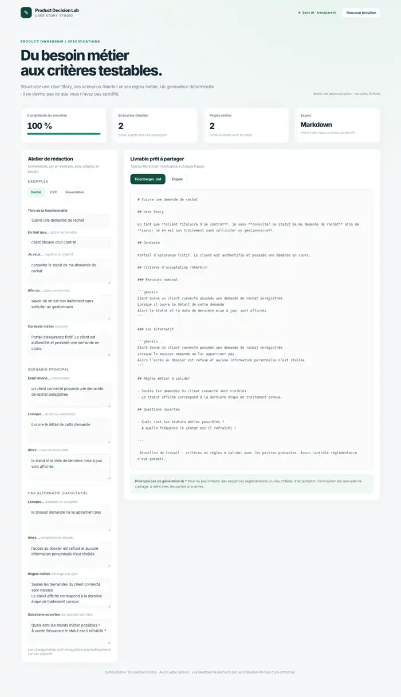

# User Story Studio

**A deterministic story-writing workbench for Product Owners and Business Analysts.**

Compose a user story from a persona, desired capability, and expected benefit. Document a principal scenario, an optional edge case, business rules and open questions. Export clean Markdown with Gherkin acceptance scenarios.

## Problem → product response

Teams often confuse a short feature description with a fully specified requirement. Valuable questions are postponed until implementation. A lightweight writing template can encourage explicit business outcomes and verifiable acceptance criteria without claiming to replace discovery.

The studio organizes the drafting conversation and **never invents regulations, business rules, or acceptance criteria**. It only produces a Gherkin scenario when the user supplies the Given / When / Then elements.

## Live demo / local run

- **Live demo:** once GitHub Pages is enabled, `https://goldaj.github.io/user-story-studio/`.
- **Offline:** download the repository and open `index.html` in your browser. No server, account, API key, or installation required.
- **Optional automated tests:** `node tests.js` (Node.js 18+).

## Features

- Three fictional insurance-related examples: contract withdrawal, KYC documentation, subscription continuation.
- Live user story and Markdown preview.
- Happy path and exception case translated into Gherkin when supplied.
- Business rules and open questions, one per line.
- Draft-completeness indicator (number of ten filled **fields**, not a quality or INVEST score).
- Markdown download, copy to clipboard where supported, browser-only draft persistence.

## Product thinking

- **Users:** Product Owner, Business Analyst, developer, QA engineer.
- **Job to be done:** Convert a business discussion into a shareable, testable first draft.
- **Value hypothesis:** Explicit scenarios and unresolved questions reduce clarification cycles during implementation.
- **Validation metrics:** proportion of stories with acceptance cases, clarification questions after refinement, average time from discovery to first testable draft.
- **Deliberate trade-off:** deterministic transformations instead of LLM-assisted requirements. Accuracy and traceability matter more than plausible-sounding output.

## Review scenario

1. Open the KYC example.
2. Edit the exceptional case to describe a different failure mode.
3. Remove the expected outcome and observe that the main scenario is no longer included.
4. Download a `.md` file for a product backlog refinement meeting.

Sample examples are fictional and do not reflect proprietary company processes or regulatory advice.

## Technologies

HTML, CSS, vanilla JavaScript, localStorage, Markdown. Zero external dependencies. MIT license.
